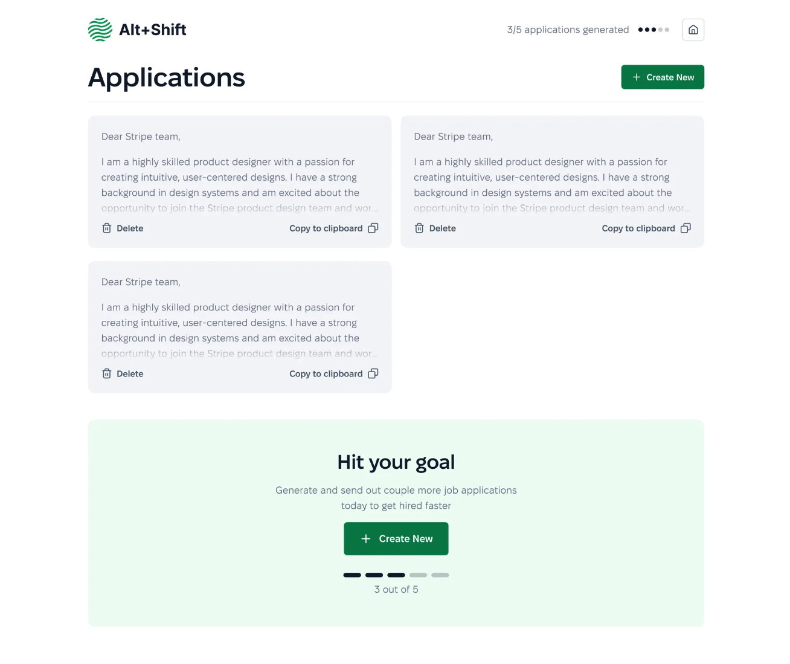
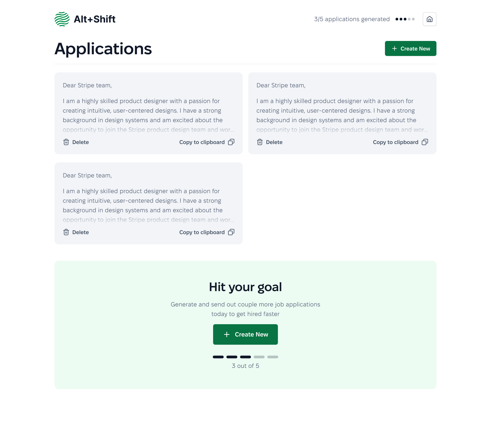

# AI-Powered Cover Letter Generation
Mockups: https://www.figma.com/design/9WUKe9EbiuhelC4dnSFIfw/Test-Assignment--Copy-?node-id=4-11215&t=ntCnGqTpnhsXxV0C-0

---
## Assignment

Develop a small application for generating cover letter texts, consisting of two screens:

Dashboard with a list of created letters:

Form for generating a new letter:



### Details

- The application's goal is to motivate the user to create at least 5 letters. A banner showing the current count is displayed until there are fewer letters.
- The application doesn't have any server database, but should be able to restore cover letters that were created in the same browser. If you close the tab and open it again — the list of created letters should remain the same.
- The mockups intentionally don't use any design system or ready-made React UI kit. Finding patterns, systematizing components and styles is one of the key parts of the test assignment.
- The mockups don't include a mobile version — you need to create it yourself.
- For letter generation, you can use the following letter template (or any other at your discretion):

```
Dear [Company] Team,

I am writing to express my interest in the [JobTitle] position.

My experience in the realm combined with my skills in [SkillsList] make me a strong candidate for this role.

[AdditionalDetails]

I am confident that my skills and enthusiasm would translate into valuable contributions to your esteemed organization.

Thank you for considering my application. I eagerly await the opportunity to discuss my qualifications further.

```

### Additional Tasks (optional)

- Simulate long (2-3 sec) text generation and show a loading state as shown in the design.
- Implement AI for writing letters. Connect to the OpenAI API (or another of your choice), create a prompt and link it with form data, so that instead of using a static template, the model writes dynamic texts.

### Stack

Must use React and TypeScript. Preferably **not** use Tailwind.

Everything else — at your discretion.

---


## Getting Started

1. `yarn` - install packages
2. `npm run dev` - start development mode

If you need a build, it's done like this:

1. `npm run build` - build the project
1. `npm run preview` - run the build

## About the Project

### Technologies

1. `React` - Main framework
2. `Vite` - Bundler
3. `Css Modules` - Styles
4. `Zustand` - State manager
5. `Open AI` as business integration

### Architecture

Although the project is small, I built it using [FSD](https://feature-sliced.design/) architecture.

#### `app`

For storing functionality related to the entire application

#### `pages`

For storing pages. Pages should preferably be thin, so that the main logic is in widgets, features, and entities.

#### `widgets`

For reusable full-fledged blocks with their own logic.

#### `features`

For storing user interactions.

#### `entities`

For storing business entities. Often these entities correspond to backend entities. In our case, these are `application` and `open-ai`.

#### `shared`

Common reusable code.

# Result:
## Main Tasks

#### 1. The application should be able to restore cover letters that were created in the same browser

✅ `Zustand` is connected to `localstorage` via `persist middleware`.

#### 2. The mockups intentionally don't use any design system or ready-made React UI kit.

✅ A developed UI-kit is stored in `src\shared\ui` which can be conveniently replaced with any libraries if needed.
✅ There are also CSS variables for convenient theme management `src\app\styles\theme.css`

#### 3. The mockups don't include a mobile version — you need to create it yourself.

✅ Mobile version is implemented, `iPhoneSE` in `Chrome devtools` was taken as the smallest screen

#### 4. For letter generation, you can use the following letter template (or any other at your discretion):

A more advanced option from the additional tasks was chosen

## Additional Tasks

#### 1. Simulate long (2-3 sec) text generation and show a loading state as shown in this prototype.

✅ Simulation and loading animation implemented

#### 2. Implement AI for writing letters

✅ Integration with `OpenAI` completed

#### 3. Publish the site for convenience

✅ Done 
https://vg-five-xi.vercel.app

## What We Will Pay Attention to During Review

#### Code clarity and scalability

FSD approach in code formatting, excellent option in terms of scalability

#### Design understanding and attention to detail, layout and responsiveness quality

Besides what is shown in the mockups, I added additional logic, for example:

- Added necessary button states: loading, disable, hover, active
- Animated the loading icon on the button
- Checked content overflow in inputs, fixed bugs if any
- Created a theme for convenience and understanding

#### Understanding React and following best practices

There are no errors or warnings in the console.
Besides basic eslint, prettier, typescript, and others, I added `react compiler` to React 19 for improved performance
This is what it looks like when the compiler is working =)


#### Project structure

I tried to make everything clear and neat. Of course, for such a small project, a simpler approach could have been taken to make the code even clearer, but I was thinking more about potential scalability, which can happen with any project.

## Extra Features

### Editing

Besides creating a recommendation letter, I also implemented an editing function, which seems to be the necessary minimum for an application. I believe this significantly improves the user experience.

### Error Handling

1. `ErrorLogger` - logging service, if you need to add Sentry, it can and should be done in only one place
2. `setupGlobalErrorHandlers` - for backup and catching global errors
3. `ErrorBoundary` - for catching errors inside components, so that the application continues to partially work in case of failure, instead of crashing completely with a white screen

### Accessibility

You can navigate through the entire application via tab without a mouse

### Metrics

Already published on the free version of Vercel


### 404 Page

Not difficult, but pleasant for the user

### Cover Letter Generation

On small screens, I organized the form on top and the generated letter below, and made a scroll to it when clicked

### Fonts

Using `rel="preload"` I removed font flickering

## What I Would Discuss with the Designer (all minor)

- In mockups, it's preferable to use sizes divisible by 2 or 4, for example in the logo the spacing between the icon and "Alt+Shift" is 12.67px, I take 12 (I didn't see any more such moments, so this question can be skipped)
- Bug: `Generate Now` button changes size from 60 to 56 during loading
- In the button with the house icon, the icon color is rgba(52, 64, 84, 1), in the "copy to clipboard" button it's rgba(71, 84, 103, 1) — clarify if this is an error, because the difference is almost invisible to the eye
- On the main page with a large number of cards, you could fix the Header and make scrolling only below, in the cards block
